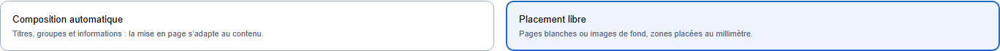
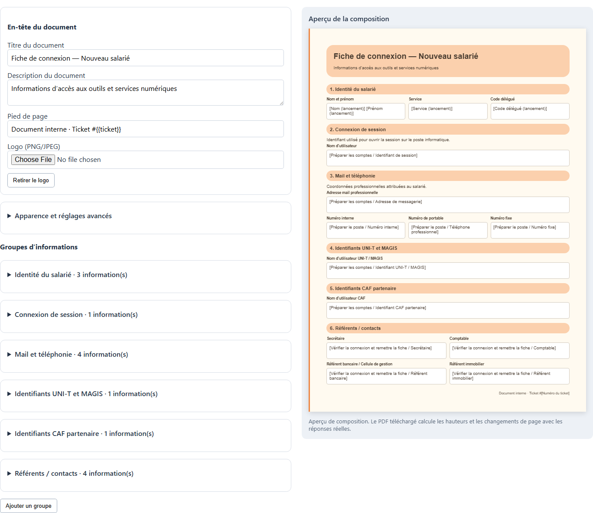
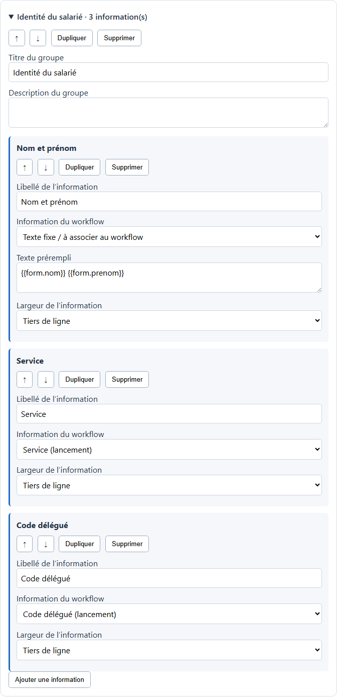
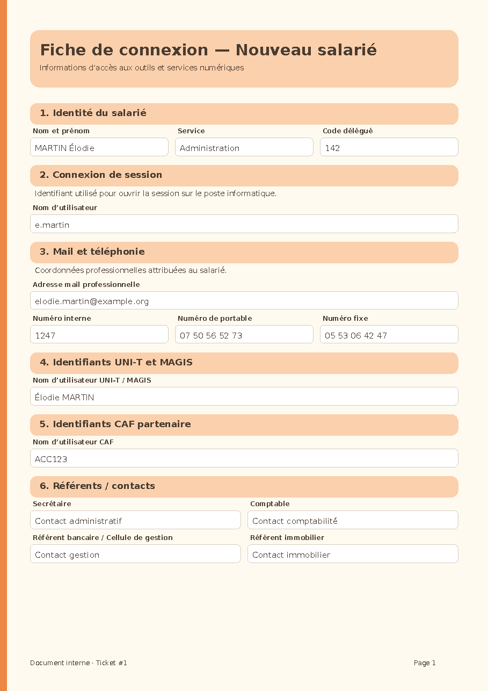
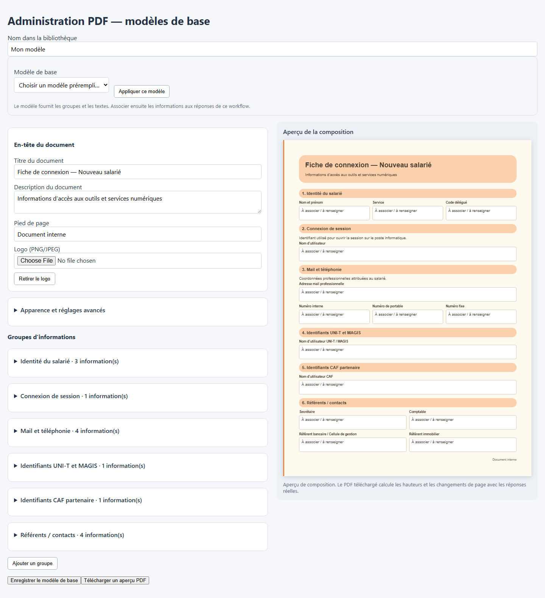
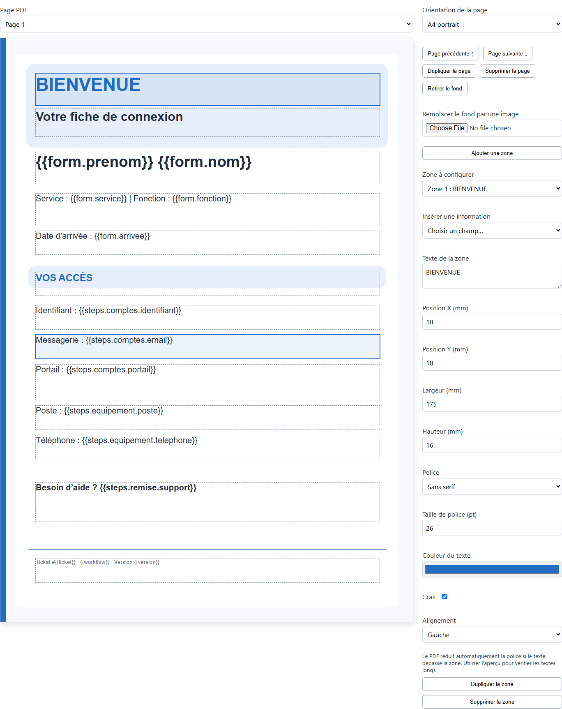
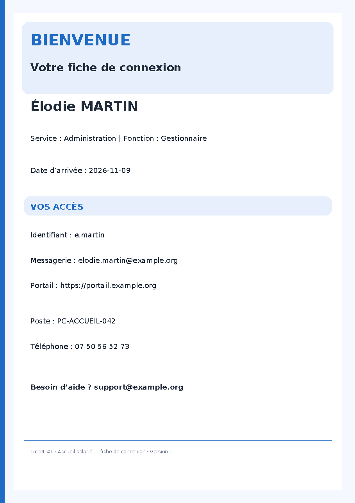
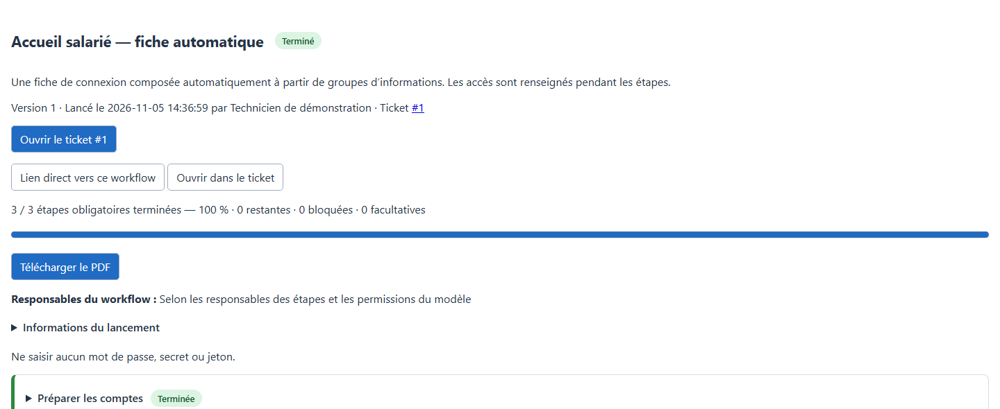

# Tutoriel PDF — de la première fiche au modèle réutilisable

Ce tutoriel explique pas à pas comment produire une fiche de connexion salarié avec Workflow Builder **0.4.0** pour GLPI 12. Deux méthodes sont disponibles : **composition automatique** et **placement libre**. Vous trouverez ici deux workflows JSON prêts à importer, des captures de l’éditeur et des exemples du résultat.

> Les captures montrent les composants réels du plugin dans une démonstration autonome. Les réponses et personnes sont fictives. Les menus et couleurs de l’environnement GLPI peuvent varier selon votre thème et vos droits. Le tutoriel et toutes ses images sont livrés avec le plugin : il est consultable dans GLPI sans accéder à GitHub.

[Retour au guide utilisateur](user-guide.md)

## Sommaire

- [Choisir la bonne méthode](#choisir-la-bonne-méthode)
- [Télécharger et importer les deux exemples](#télécharger-et-importer-les-deux-exemples)
- [Créer une fiche avec la composition automatique](#créer-une-fiche-avec-la-composition-automatique)
- [Préparer des modèles de base dans l’administration](#préparer-des-modèles-de-base-dans-ladministration)
- [Créer une fiche avec le placement libre](#créer-une-fiche-avec-le-placement-libre)
- [Publier, remplir le workflow et télécharger le PDF](#publier-remplir-le-workflow-et-télécharger-le-pdf)
- [Comprendre les données et les versions](#comprendre-les-données-et-les-versions)
- [Résoudre les difficultés courantes](#résoudre-les-difficultés-courantes)

## Choisir la bonne méthode

Dans l’éditeur d’un modèle, ouvrir **Document PDF** et cocher **Activer le téléchargement PDF en fin de workflow**. Choisir ensuite une méthode :

| Votre besoin | Mode conseillé | Ce que vous configurez |
| --- | --- | --- |
| Une fiche claire avec des rubriques, des champs et des colonnes | **Composition automatique** | Le titre, la description, les groupes, les informations et leurs largeurs. Le moteur calcule les positions et les changements de page. |
| Reprendre un formulaire ou placer chaque réponse à un endroit précis | **Placement libre** | Des pages blanches ou des fonds PNG/JPEG, puis des zones de texte avec positions, tailles et styles. |

*Changer de mode conserve les deux configurations dans le brouillon. Le PDF final utilise uniquement le mode sélectionné. Les anciens modèles restent en placement libre.*

**Pour un premier essai, commencer par l’exemple automatique.** Aucun fond de page et aucun réglage de coordonnées ne sont nécessaires.

## Télécharger et importer les deux exemples

### Les fichiers prêts à importer

| Exemple JSON | Contenu du PDF | Réglages fournis |
| --- | --- | --- |
| [Fiche salarié — composition automatique](../examples/fiche-connexion-automatique.json) | Identité, connexion de session, mail et téléphonie, UNI-T/MAGIS, CAF et référents | Six groupes, colonnes et associations aux champs déjà configurées. Le récapitulatif supplémentaire est désactivé. |
| [Fiche salarié — placement libre](../examples/fiche-connexion-salarie.json) | Une page d’accès et une page de consignes | Fond décoratif intégré sur la première page, zones et variables déjà placées, récapitulatif complet activé après les deux pages. |

Les fichiers contiennent la **définition du workflow**, sans données de salarié ni historique d’exécution. Les images intégrées suivent le JSON lors de l’import et de l’export. Il n’y a aucun dossier d’images à recopier pour utiliser ces exemples.

### Importer dans GLPI

1. Ouvrir **Assistance → Workflows**.
2. Déplier **Importer un modèle ou un exemple**.
3. Choisir le JSON téléchargé dans **Fichier JSON**, en laissant **Ou exemple** sur **Aucun**. Vous pouvez aussi sélectionner directement **Fiche salarié — PDF automatique** ou **Fiche de connexion salarié (PDF)** dans la liste des exemples fournis.
4. Cliquer sur **Importer**. Le modèle apparaît en brouillon dans l’entité active.
5. Ouvrir ce brouillon. Vérifier le formulaire, les trois étapes et l’onglet **Document PDF**.
6. Adapter les responsables et permissions à votre organisation, puis **Enregistrer le brouillon** et **Publier une nouvelle version**.

Il est possible d’importer les deux fichiers pour comparer leurs méthodes. Les identifiants d’utilisateurs, groupes et articles GLPI d’une autre installation ne donnent aucun droit à l’import.

## Créer une fiche avec la composition automatique

### 1. Vérifier l’en-tête et l’aperçu

Dans **Document PDF**, sélectionner **Composition automatique**.

- **Titre du document** : par exemple « Fiche de connexion — Nouveau salarié ».
- **Description du document** : par exemple « Informations d’accès aux outils et services numériques ».
- **Pied de page** : par exemple `Document interne · Ticket #{{ticket}}`.
- **Logo (PNG/JPEG)** : facultatif. Il est placé dans l’en-tête et conservé dans le workflow.

La configuration est à gauche, l’aperçu de composition à droite. Les changements de titre et de contenu apparaissent immédiatement dans cet aperçu.

*Les valeurs entre crochets représentent les champs du workflow. Les véritables réponses seront utilisées lors du téléchargement final. La numérotation des groupes, les bandeaux et les cadres sont générés automatiquement.*

### 2. Créer les groupes

Cliquer sur **Ajouter un groupe**, puis ouvrir son bloc. Renseigner :

- **Titre du groupe** : par exemple « Identité du salarié ».
- **Description du groupe** : facultative, pour expliquer le contenu de cette rubrique.

Ajouter les autres groupes souhaités : connexion, coordonnées, outils, contacts, consignes… Les flèches et le glisser-déposer permettent de changer leur ordre. **Dupliquer** copie un groupe avec ses informations ; **Supprimer** demande confirmation.

L’exemple automatique fourni contient déjà six groupes. Vous pouvez les modifier directement.

### 3. Ajouter une information et la relier à une réponse

Dans un groupe, cliquer sur **Ajouter une information** :

1. Remplir **Libellé de l’information**, par exemple « Service ».
2. Dans **Information du workflow**, sélectionner le champ **Service (lancement)**.
3. Choisir **Largeur de l’information → Tiers de ligne**.
4. Faire de même pour les autres informations du groupe.

*Dans cette capture, le service et le code délégué sont liés au formulaire de lancement. Le nom et le prénom sont réunis par un texte utilisant deux variables.*

| Information affichée | Champ ou texte dans l’exemple |
| --- | --- |
| Nom et prénom | Laisser **Texte fixe / à associer au workflow**, puis saisir `{{form.nom}} {{form.prenom}}` dans **Texte prérempli**. |
| Service | Sélectionner **Service (lancement)**. |
| Code délégué | Sélectionner **Code délégué (lancement)**. |
| Identifiant de session | Sélectionner le champ **Identifiant de session** de l’étape **Préparer les comptes**. |
| Adresse mail | Sélectionner le champ **Adresse de messagerie** de cette même étape. |
| Nom du poste | Sélectionner le champ **Nom du poste** de l’étape **Préparer le poste**, si vous ajoutez cette information. |

Pour afficher un texte commun, laisser le choix **Texte fixe / à associer au workflow** et renseigner **Texte prérempli**, par exemple « Contacter le support informatique en cas de difficulté ». Ce texte peut également mélanger des mots fixes et des variables.

**L’exemple JSON est déjà relié à ses champs.** Appliquer une autre base remplace sa composition automatique : les informations de la nouvelle base doivent alors être associées aux réponses de ce workflow.

### 4. Choisir les colonnes

Chaque information peut occuper :

- **Ligne entière** : adresse mail, URL, consignes ou information longue.
- **Moitié de ligne** : deux contacts côte à côte.
- **Tiers de ligne** : nom/service/code, ou trois numéros de téléphone.

Les informations suivent leur ordre. Lorsque la ligne n’a plus assez de place, la suivante commence automatiquement. La hauteur de chaque ligne s’adapte aux réponses.

### 5. Personnaliser l’apparence

Déplier **Apparence et réglages avancés** pour choisir une palette orange ou bleue, une police et la taille du texte de 8 à 14 points. Les couleurs d’accent, des bandeaux, du fond et du texte peuvent être modifiées. La numérotation des groupes peut être désactivée.

Cliquer sur **Télécharger un aperçu PDF** pour vérifier le rendu des polices. Cet aperçu utilise des libellés de démonstration, sans créer de ticket ni enregistrer le brouillon. La composition visible dans l’éditeur ne prédit pas exactement les changements de page du document rempli.

### Exemple de résultat

*Avec des réponses courtes, les six groupes de l’exemple tiennent sur une page A4. Des réponses longues produisent des pages supplémentaires ; les groupes et libellés sont repris sur les continuations.*

## Préparer des modèles de base dans l’administration

Une **base PDF** sert de point de départ commun : titre, description, logo, couleurs, groupes, libellés et textes à proposer aux créateurs de workflows.

### 1. Créer une base commune

1. Ouvrir **Administration PDF → Modèles de base** dans la navigation du plugin.
2. Cliquer sur **Nouveau modèle de base**.
3. Renseigner **Nom dans la bibliothèque**, par exemple « Fiche d’accueil — présentation de l’association ».
4. Pour démarrer rapidement, sélectionner **Fiche de connexion salarié** ou **Document sobre**, puis **Appliquer ce modèle**.
5. Adapter l’en-tête, le logo, les groupes et les textes communs.
6. Laisser **Proposer ce modèle aux workflows** coché et cliquer sur **Enregistrer le modèle de base**.

*La capture illustre l’éditeur de base sur des données de démonstration. Dans GLPI, la bibliothèque située au-dessus du formulaire permet de retrouver les bases enregistrées.*

L’accès à cette administration exige le droit Workflow Builder **Administrer les droits et remplacer les responsables — Modifier**. La base est enregistrée dans l’entité active lors de sa création. Les créateurs de workflows qui disposent de l’accès à cette entité la retrouvent dans le sélecteur.

### 2. Utiliser la base dans un workflow

1. Ouvrir le brouillon du workflow, puis **Document PDF → Composition automatique**.
2. Sélectionner la base dans **Modèle de base**, cliquer sur **Appliquer ce modèle** et confirmer le remplacement de la composition.
3. Ouvrir chaque groupe pour associer ses informations aux champs propres à ce workflow.
4. Vérifier l’aperçu, enregistrer et publier.

Une base ne connaît pas les champs d’un formulaire particulier. Vous préparez les libellés et textes communs dans l’administration, puis vous choisissez les réponses à afficher dans chaque workflow. Les variables générales comme `{{workflow}}` et `{{ticket}}` peuvent être utilisées dans la base.

### 3. Modifier ou désactiver une base

Sélectionner la base dans la bibliothèque, modifier son contenu et enregistrer. Décocher **Proposer ce modèle aux workflows** pour la retirer des nouveaux choix.

Chaque workflow conserve sa **propre copie**. Modifier ou désactiver une base ne change pas les brouillons déjà configurés, les versions publiées ou les workflows lancés. Pour reprendre une modification de base, l’appliquer de nouveau dans le brouillon, refaire les associations nécessaires puis publier.

## Créer une fiche avec le placement libre

### 1. Préparer les pages

Dans **Document PDF**, choisir **Placement libre**. Le JSON fourni contient déjà deux pages ; la première utilise le [fond décoratif de démonstration](../public/images/guide/pdf-demo-background.png).

Pour créer vos pages :

1. Cliquer sur **Ajouter une page blanche**, ou sur **Importer des images comme pages** pour sélectionner un ou plusieurs fichiers PNG/JPEG.
2. Chaque image importée devient le fond d’une nouvelle page A4. Choisir portrait ou paysage dans l’inspecteur.
3. Pour changer seulement le fond de la page courante, utiliser **Remplacer le fond par une image** : les zones déjà placées restent présentes.

Les images sont centrées et ajustées sans déformation. Une image aux proportions A4 évite des marges supplémentaires. Un PDF existant doit d’abord être exporté en images si vous souhaitez l’utiliser comme fond.

### 2. Placer les informations

Cliquer sur **Ajouter une zone**. Sélectionner la zone sur la page ou dans **Zone à configurer**, puis :

1. Dans **Texte de la zone**, saisir du texte fixe ou insérer une variable avec **Insérer une information**.
2. Déplacer la zone à la souris. Au clavier : sélectionner avec Entrée, puis utiliser les flèches pour un déplacement de 1 mm, ou Maj + flèche pour 5 mm.
3. Ajuster les positions et dimensions depuis le coin supérieur gauche de la page : **X**, **Y**, **Largeur**, **Hauteur**, en millimètres.
4. Choisir la police, la taille de 6 à 72 points, la couleur, le gras et l’alignement.
5. Dupliquer les zones proches, puis changer leurs textes et positions.

*Les rectangles en pointillés sont des repères de l’éditeur ; ils ne sont pas imprimés. Le fond et les textes sont conservés séparément dans la définition du workflow.*

### 3. Utiliser les variables

| Variable | Contenu |
| --- | --- |
| `{{workflow}}` | Nom du workflow. |
| `{{ticket}}` | Numéro du ticket. |
| `{{version}}` | Numéro de la version publiée du modèle. |
| `{{date_creation}}` et `{{date_completion}}` | Dates de lancement et de fin. |
| `{{form.prenom}}` | Prénom saisi au lancement dans l’exemple. |
| `{{steps.comptes.identifiant}}` | Identifiant renseigné dans l’étape `comptes`. |
| `{{steps.remise.support}}` | Contact support renseigné dans l’étape `remise`. |

Par exemple : `Identifiant : {{steps.comptes.identifiant}}`.

Le sélecteur liste les champs disponibles dans votre workflow. Il ajoute la variable à la fin du texte de la zone ; vous pouvez ensuite la déplacer dans ce texte. Les identifiants stables des champs et des étapes sont visibles dans leurs blocs d’édition.

### 4. Vérifier le rendu

Télécharger un aperçu PDF. Le texte d’une zone trop petite est réduit automatiquement pour tenir dans son rectangle : agrandir la zone ou diminuer la quantité de texte pour garder une bonne lisibilité. Une zone ne se prolonge pas automatiquement sur une autre page en placement libre ; utiliser un autre bloc ou le récapitulatif complet pour les contenus longs.

*Le JSON fourni crée une page d’accès, une page de consignes puis le récapitulatif complet. Cette illustration montre uniquement sa première page.*

## Publier, remplir le workflow et télécharger le PDF

### 1. Enregistrer puis publier

Le PDF fait partie de la définition du workflow. Après la configuration :

1. Cliquer sur **Enregistrer le brouillon**.
2. Dans **Publication et versions**, cliquer sur **Publier une nouvelle version**.
3. Lancer un **nouveau workflow** à partir de ce modèle publié.

Modifier un brouillon ne change pas les workflows déjà lancés. Pour essayer le PDF modifié, il faut publier puis effectuer un nouveau lancement.

### 2. Essayer avec des réponses fictives

Les deux exemples suivent les mêmes trois étapes :

| Moment | Réponses possibles pour l’essai |
| --- | --- |
| Lancement | Prénom Élodie, nom MARTIN, service Administration, fonction Gestionnaire, arrivée 9 novembre 2026 ; code délégué 142 pour l’exemple automatique. |
| **Préparer les comptes** | Identifiant `e.martin`, mail `elodie.martin@example.org`, portail `https://portail.example.org`, confirmation MFA ; identifiants UNI-T/MAGIS et CAF facultatifs dans l’exemple automatique. |
| **Préparer le poste** | Poste `PC-ACCUEIL-042`, téléphone et, dans l’exemple automatique, numéros interne et fixe. |
| **Vérifier la connexion et remettre la fiche** | Support `support@example.org`, consignes, confirmation du test de connexion et contacts facultatifs. |

Prendre en charge et terminer les étapes dans l’ordre. Les cases de vérification obligatoires doivent être cochées. Les champs de mots de passe, secrets et jetons ne sont pas pris en charge : transmettre les données confidentielles par le canal sécurisé de votre organisation.

### 3. Retrouver le ticket et récupérer le PDF

Dans un workflow lancé, le bouton **Ouvrir le ticket #…** mène directement à son ticket. Le lien **Ouvrir dans le ticket** mène à l’onglet Workflow et cible cette instance.

Lorsque toutes les étapes obligatoires applicables sont terminées, le bouton **Télécharger le PDF** apparaît. Le document est généré à la demande avec les réponses enregistrées.

Les étapes facultatives peuvent rester ouvertes même si le workflow est terminé. Les compléter avant le téléchargement si leurs réponses sont attendues sur la fiche. Une réouverture d’étape obligatoire retire temporairement le téléchargement, jusqu’à la nouvelle fin du workflow.

### 4. Choisir le récapitulatif complet

Cocher **Ajouter le récapitulatif complet après les pages personnalisées** pour ajouter les réponses, les états, les responsables, les opérateurs, les dates et les commentaires à la suite du document. Il peut occuper plusieurs pages et fonctionne avec les deux modes.

Ce réglage est indépendant du récapitulatif envoyé dans les suivis du ticket. Dans l’exemple automatique il est désactivé pour produire une fiche courte ; dans l’exemple libre il est activé pour montrer les deux usages.

## Comprendre les données et les versions

- Les modèles PDF, les groupes et les zones sont enregistrés avec le workflow dans la base GLPI. Les images et logos sont intégrés au JSON en Base64.
- Chaque version publiée conserve son modèle. Un workflow lancé utilise cette version même si un administrateur modifie ensuite le brouillon ou une base commune.
- Le téléchargement utilise les réponses enregistrées au moment où vous le demandez. Il ne copie pas les réponses des autres workflows du ticket.
- Les champs masqués par leurs conditions et les étapes non applicables ne fournissent pas de réponse au PDF. Les références GLPI sont affichées selon les droits de lecture.
- Le PDF est téléchargé localement. Il n’est ni envoyé automatiquement, ni joint automatiquement au ticket.
- L’export JSON sert à partager le modèle, pas à sauvegarder les réponses et l’historique. La sauvegarde de la base GLPI reste nécessaire.

## Résoudre les difficultés courantes

| Situation | Vérification ou action |
| --- | --- |
| Le bouton PDF n’apparaît pas | Activer le PDF dans le modèle, enregistrer, publier, puis lancer un nouveau workflow. Terminer les étapes obligatoires applicables. |
| Une ancienne fiche apparaît | L’instance conserve sa version d’origine. Publier puis lancer un nouveau workflow pour tester le modèle modifié. |
| Une information affiche un tiret | Associer l’information à un champ ou renseigner son texte prérempli ; vérifier que la réponse a été enregistrée et que son champ est visible. |
| Une variable est refusée à l’enregistrement | Le champ ou l’étape a été supprimé ou renommé. Choisir à nouveau le bon champ dans le sélecteur. |
| Le texte du placement libre est minuscule | Agrandir la zone, déplacer une partie du texte sur une autre page ou utiliser le mode automatique pour un contenu variable et long. |
| Le PDF automatique compte plusieurs pages | C’est attendu lorsque les réponses sont longues. Vérifier les largeurs, l’ordre des informations et le récapitulatif facultatif. |
| La base administrative n’apparaît pas | Vérifier sa disponibilité, l’accès à son entité et les droits de lecture des modèles de workflow. |
| Le lien Administration PDF n’apparaît pas | Vérifier le droit d’administration Workflow Builder en modification sur le profil. |
| Une modification concurrente est signalée | Recharger la version enregistrée avant de poursuivre. Ne pas écraser les changements de l’autre administrateur. |
| Une image ou un logo est refusé | PNG/JPEG uniquement, 2 Mio maximum par image, 6000 pixels par côté et 20 mégapixels au total. |
| Le JSON est trop volumineux | La limite est de 16 Mio, images encodées comprises. Réduire les images ; vérifier également les limites PHP, du serveur HTTP et de MariaDB. |
| Le guide ou les images ne sont pas disponibles dans GLPI | Déployer aussi le dossier docs et les images du plugin. Ce tutoriel est accessible par **Tutoriel PDF** et depuis le guide utilisateur. |

Le placement libre accepte 10 pages personnalisées et 200 zones. La composition automatique accepte 30 groupes et 200 informations, avec pagination selon le contenu. Les aperçus servent à vérifier le rendu ; ils ne remplacent pas l’essai d’un workflow rempli.

[Retour au guide utilisateur](user-guide.md)