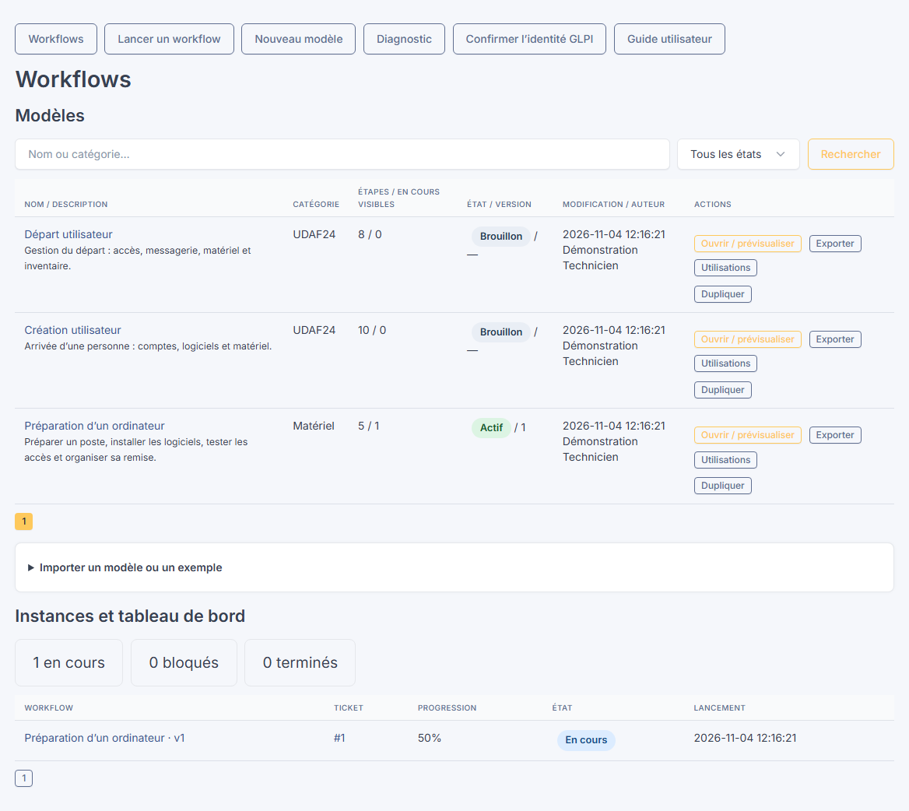
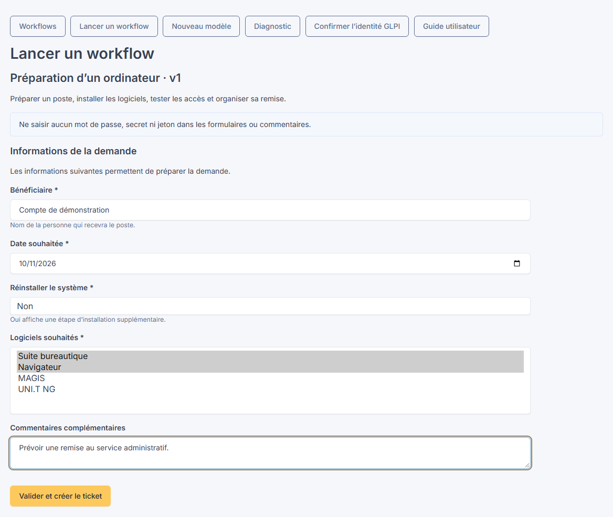
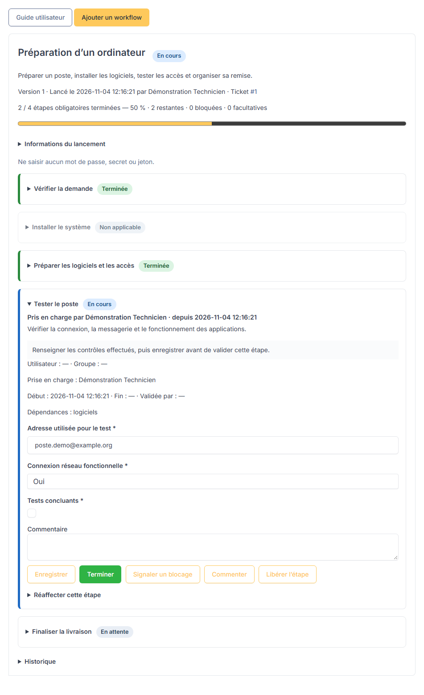
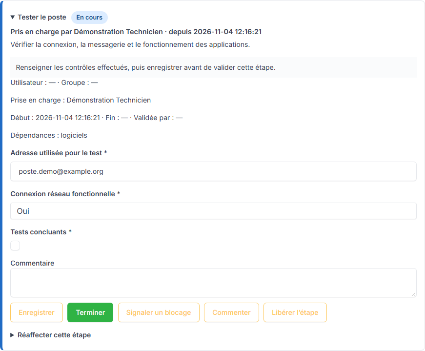
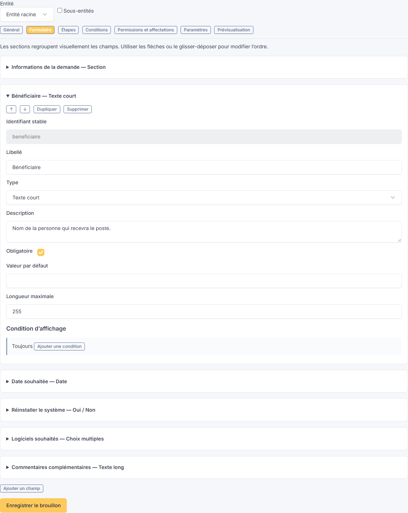
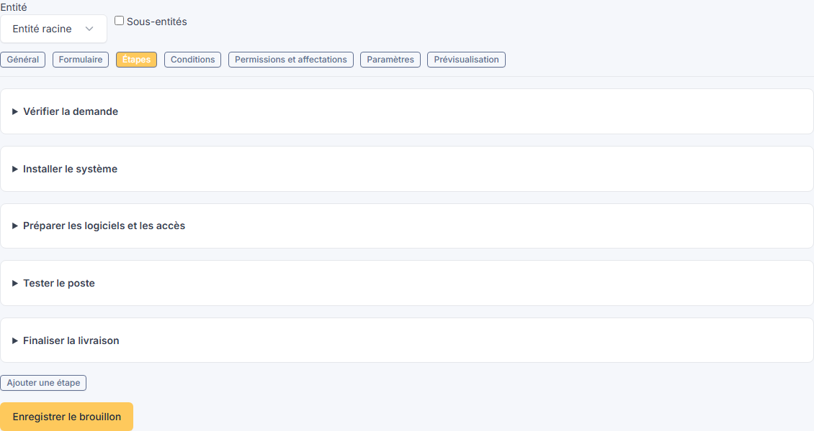
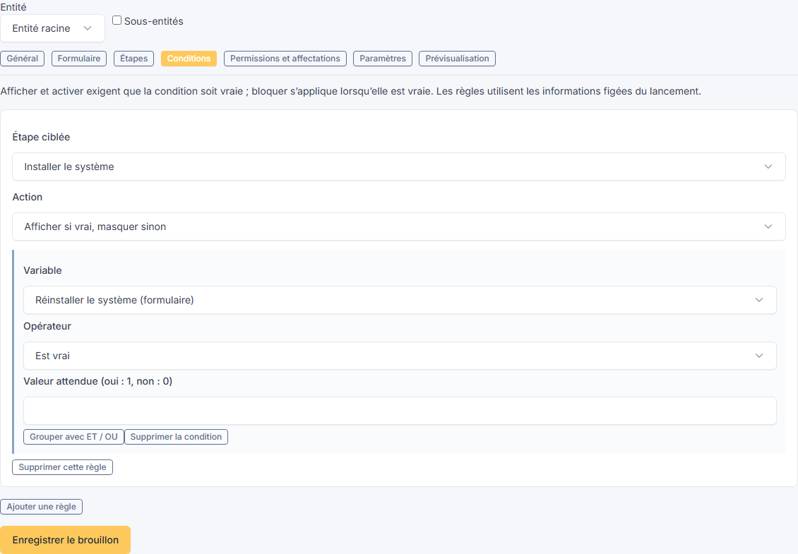
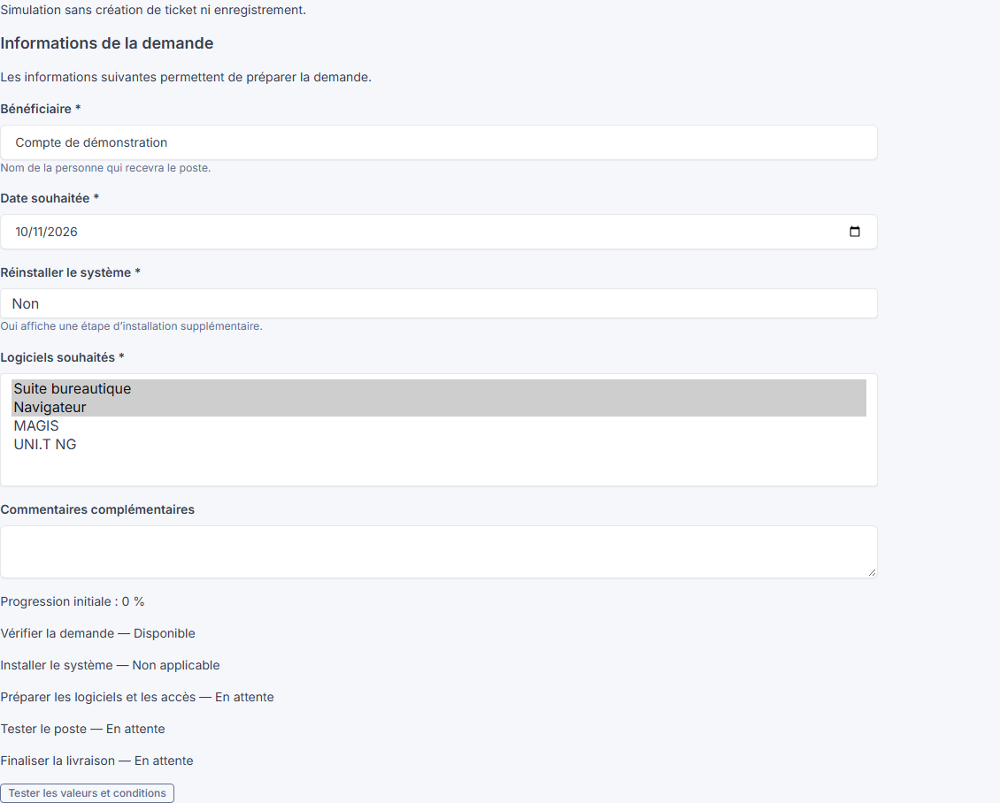
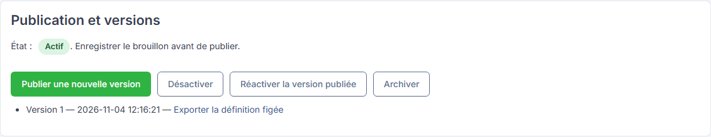
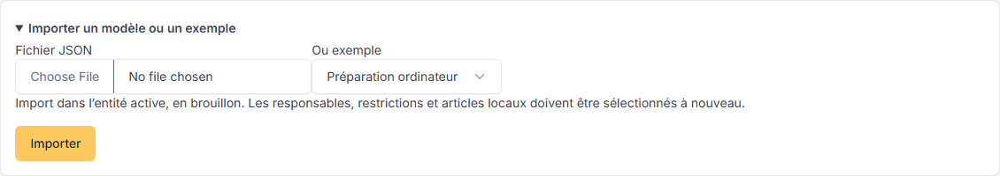

# Workflow Builder — Guide utilisateur

**Créer une procédure, la lancer sur un ticket et suivre le travail de chaque technicien.**

Ce guide accompagne Workflow Builder 0.1.2 pour GLPI 12. Il s’adresse aux **techniciens**, qui exécutent les procédures, et aux **administrateurs**, qui construisent et publient les modèles.

> **Un seul guide, deux accès.** Ce fichier Markdown est la source du bouton **Guide utilisateur** dans GLPI et du guide consultable dans le dépôt. La page GLPI lit le fichier livré avec le plugin. Déployer sa mise à jour actualise aussi le guide affiché.
>
> Dans GLPI, cliquer sur une capture pour l’ouvrir en grand dans un autre onglet. Les captures proviennent d’une instance GLPI 12 de démonstration. Les noms, données et tickets sont fictifs ; les menus disponibles chez vous dépendent de vos droits.

## Sommaire

- [Démarrer en cinq minutes](#démarrer-en-cinq-minutes)
- [Comprendre les modèles et les workflows lancés](#comprendre-les-modèles-et-les-workflows-lancés)
- [Lancer un workflow](#lancer-un-workflow)
- [Prendre en charge une étape](#prendre-en-charge-une-étape)
- [Renseigner et terminer les étapes](#renseigner-et-terminer-les-étapes)
- [Comprendre les états et la progression](#comprendre-les-états-et-la-progression)
- [Créer un modèle de workflow](#créer-un-modèle-de-workflow)
- [Configurer les conditions et les dépendances](#configurer-les-conditions-et-les-dépendances)
- [Prévisualiser et publier](#prévisualiser-et-publier)
- [Importer et exporter des modèles JSON](#importer-et-exporter-des-modèles-json)
- [Utiliser les documents et les procédures](#utiliser-les-documents-et-les-procédures)
- [Gérer les droits et les responsables](#gérer-les-droits-et-les-responsables)
- [Consulter les versions et les événements](#consulter-les-versions-et-les-événements)
- [Résoudre les difficultés courantes](#résoudre-les-difficultés-courantes)

## Démarrer en cinq minutes

| Vous êtes… | Votre parcours |
| --- | --- |
| **Technicien** | Ouvrir un ticket → onglet **Workflow** → **Ajouter un workflow** → remplir le formulaire → **Je prends en charge** sur une étape disponible → **Enregistrer**, puis **Terminer**. |
| **Technicien créant une demande** | **Assistance → Workflows → Lancer un workflow** → choisir un modèle → remplir le formulaire → **Valider et créer le ticket**. |
| **Administrateur** | **Nouveau modèle** → configurer le formulaire et les étapes → **Enregistrer le brouillon** → tester la **Prévisualisation** → **Publier une nouvelle version**. |

Pour un premier essai, un administrateur peut importer l’exemple **Préparation ordinateur**, l’adapter, puis le publier.

*La liste réunit les modèles, leurs états et leurs versions. Le tableau de bord présente les instances rattachées aux tickets auxquels vous avez accès.*

## Comprendre les modèles et les workflows lancés

Un **modèle** décrit une procédure réutilisable : son formulaire, ses étapes, ses conditions et ses permissions.

Un **workflow lancé**, aussi appelé instance, applique une **version publiée** de ce modèle à un ticket précis. Il conserve les informations saisies, les états, les opérateurs et les événements.

**Exemple :** le modèle « Préparation d’un ordinateur » peut être lancé sur dix tickets différents. Chaque ticket possède son propre avancement et ses propres réponses.

| État d’un modèle | Signification |
| --- | --- |
| **Brouillon** | Le modèle peut être préparé ou désactivé. Il n’est pas proposé pour de nouveaux lancements. |
| **Actif** | Une version a été publiée et le modèle est disponible pour les utilisateurs autorisés. |
| **Archivé** | Le modèle n’est plus proposé au lancement. Les workflows déjà lancés restent consultables. |

> Modifier un brouillon ne transforme pas les procédures déjà lancées. Une nouvelle publication s’applique aux prochains lancements.

## Lancer un workflow

### Créer un nouveau ticket

1. Ouvrir **Assistance → Workflows**.
2. Cliquer sur **Lancer un workflow**.
3. Choisir le modèle souhaité.
4. Renseigner le formulaire. L’astérisque (*) signale les champs obligatoires.
5. Cliquer sur **Valider et créer le ticket**.

Le plugin crée le ticket avec les mécanismes natifs de GLPI, puis y associe la procédure. Son titre et sa description peuvent être construits à partir des réponses du formulaire.

*Dans cet exemple, le choix « Réinstaller le système » détermine si l’étape d’installation sera applicable.*

### Utiliser un ticket existant

1. Ouvrir le ticket dans GLPI.
2. Sélectionner l’onglet **Workflow**.
3. Cliquer sur **Ajouter un workflow**.
4. Choisir le modèle, renseigner le formulaire et valider l’association.

Vous devez disposer des droits de lecture et de modification du ticket, ainsi que des droits du plugin. Réouvrir le ticket dans GLPI s’il est déjà résolu ou clos.

*Le ticket conserve la version utilisée, les réponses du lancement, la progression et la checklist.*

> Si vos modèles natifs de tickets imposent des informations supplémentaires que la page de lancement ne fournit pas, créer d’abord le ticket dans GLPI, puis lui associer le workflow.

## Prendre en charge une étape

Sur une étape **Disponible**, cliquer sur **Je prends en charge**.

Le plugin mémorise automatiquement le technicien connecté et la date. Le résumé affiche **En cours — Pris en charge par…**, même lorsque le bloc est replié. Les collègues savent ainsi qui effectue l’opération.

*Le responsable prévu dans le modèle et la personne qui a effectivement pris l’étape en charge sont deux informations distinctes.*

### Passer le relais

1. Cliquer sur **Enregistrer** pour conserver les dernières modifications.
2. Cliquer sur **Libérer l’étape**.
3. Le collègue autorisé peut ensuite cliquer sur **Je prends en charge** à son tour.

Les valeurs enregistrées sont conservées. Une étape bloquée reste bloquée après libération : le blocage doit être traité séparément.

Pendant une prise en charge, un autre technicien autorisé peut commenter, mais ne peut pas écraser les informations ou remplacer l’opérateur par une simple action d’exécution. Un administrateur peut effectuer une **réaffectation explicite avec un motif**.

Le premier enregistrement ou une validation directe identifie aussi son opérateur. Après mise à jour d’une ancienne installation, une étape déjà en cours peut indiquer **Prise en charge à confirmer** : un technicien autorisé doit alors la revendiquer.

## Renseigner et terminer les étapes

Déplier une étape pour consulter ses instructions, ses champs, sa documentation et ses responsables.

| Action | Résultat |
| --- | --- |
| **Je prends en charge** | Passe l’étape en cours et enregistre votre identité. |
| **Enregistrer** | Conserve une saisie partielle. Les champs obligatoires peuvent être complétés plus tard. |
| **Terminer** | Vérifie les champs obligatoires et les dépendances, puis valide l’étape. |
| **Signaler un blocage** | Place l’étape dans l’état Bloquée. Un commentaire est obligatoire. |
| **Commenter** | Ajoute un événement sans modifier les réponses enregistrées. |
| **Libérer l’étape** | Retire votre prise en charge pour permettre un relais. Enregistrer les modifications auparavant. |
| **Débloquer** | Rend l’étape de nouveau disponible si les règles le permettent. Un droit adapté et un commentaire sont nécessaires. |
| **Réouvrir** | Reprend une étape terminée avec le droit adapté et un commentaire. |

Les validations sont effectuées côté serveur :

- une **case à cocher obligatoire** doit être cochée ;
- un **Oui/Non obligatoire** accepte aussi **Non** ;
- les emails, URL, dates, nombres et choix doivent respecter leur format ;
- les champs masqués par une condition sont exclus de la validation ;
- une étape ne peut pas être validée si ses dépendances ne sont pas satisfaites.

> Enregistrer avant de quitter la page. Les informations enregistrées restent présentes après rechargement. Si un collègue a modifié l’instance, une page obsolète est refusée : la recharger avant de poursuivre.

## Comprendre les états et la progression

| État | Ce qu’il signifie |
| --- | --- |
| **En attente** | Des étapes préalables doivent encore être terminées. |
| **Disponible** | L’étape peut être prise en charge par une personne autorisée. |
| **En cours** | Le travail a commencé ; l’opérateur apparaît dans le résumé. |
| **Terminée** | Les validations ont été satisfaites. La date et l’auteur sont conservés. |
| **Bloquée** | Un technicien ou une règle empêche de poursuivre. |
| **Non applicable** | Les réponses du lancement rendent l’étape inutile pour cette demande. |

La progression compte **uniquement les étapes obligatoires applicables**.

**Exemple :** un modèle comporte cinq étapes ; l’installation du système n’est pas nécessaire. Quatre étapes obligatoires restent applicables. Si deux sont terminées, la progression est de **50 %**.

Les étapes facultatives restent accessibles, mais ne bloquent pas la fin. Une étape non applicable satisfait ses dépendances. Avec zéro étape obligatoire applicable, la progression vaut 100 %.

### Résoudre ou clôturer le ticket

La fin du workflow ne ferme pas automatiquement le ticket.

Si le modèle impose le contrôle de clôture, toutes les étapes obligatoires de **toutes les instances concernées** doivent être terminées avant résolution ou clôture du ticket. Après résolution ou clôture, réouvrir le ticket dans GLPI avant de modifier ses étapes.

## Créer un modèle de workflow

Cette partie est destinée aux administrateurs disposant des droits de gestion des modèles.

Cliquer sur **Nouveau modèle**, choisir son entité et configurer les sept onglets.

| Onglet | À quoi il sert |
| --- | --- |
| **Général** | Nom, description, catégorie et icône. |
| **Formulaire** | Informations à recueillir au lancement. |
| **Étapes** | Actions, instructions, champs, responsables et procédures. |
| **Conditions** | Règles d’affichage, d’activation ou de blocage. |
| **Permissions et affectations** | Personnes et groupes pouvant lancer, exécuter ou gérer le modèle. |
| **Paramètres** | Modes de lancement, titre du ticket et contrôle de clôture. |
| **Prévisualisation** | Simulation des réponses et des étapes applicables, sans créer de ticket. |

### Construire le formulaire

1. Dans **Formulaire**, cliquer sur **Ajouter un champ**.
2. Choisir un type et définir le libellé.
3. Ajouter une description pour expliquer la réponse attendue.
4. Activer **Obligatoire** lorsque la réponse est nécessaire.
5. Définir, selon le type, les choix, la valeur par défaut, les bornes ou la longueur maximale.

*Chaque bloc possède un identifiant stable. Les flèches et le glisser-déposer permettent de modifier l’ordre.*

| Famille | Types disponibles |
| --- | --- |
| Texte | Texte court, texte long, email et URL. |
| Valeurs | Nombre, date, date et heure. |
| Choix | Case à cocher, Oui/Non, liste déroulante, boutons radio et choix multiples. |
| Références GLPI | Utilisateur, groupe, entité, ordinateur et document du ticket. |
| Présentation | Section descriptive regroupant les champs suivants. |

Pour une liste, saisir **un choix par ligne**. Une section n’est pas un champ de réponse. Une condition de champ ne peut utiliser que les champs précédents du même formulaire.

### Construire les étapes

Dans **Étapes**, ajouter un bloc pour chaque action à réaliser. Renseigner son titre, ses instructions, son obligation, ses responsables, ses dépendances et ses champs.

*Déplier un bloc pour le configurer. Une étape peut avoir plusieurs champs et plusieurs articles de connaissance.*

Une étape peut être dupliquée, déplacée ou supprimée du brouillon. Avant de supprimer une étape utilisée par d’autres, retirer les règles et dépendances qui la référencent.

**Exemple :** « Créer un compte Microsoft 365 » peut demander l’adresse créée, le type de licence, une date et une case de contrôle. Ce modèle reste une procédure suivie par le technicien : le plugin ne crée pas automatiquement le compte dans le service externe.

### Définir le ticket créé au lancement

Dans **Paramètres**, autoriser la création d’un ticket, l’association à un ticket existant, ou les deux.

Le titre peut utiliser **{{workflow}}** pour le nom du modèle et **{{identifiant_du_champ}}** pour une réponse du formulaire. L’identifiant stable est visible dans le bloc du champ. La variable **{{summary}}** fournit un résumé des réponses pour la description.

Activer le contrôle de clôture si les étapes obligatoires doivent être terminées avant la résolution du ticket. Les variables remplacent du texte ; elles n’exécutent pas de code.

## Configurer les conditions et les dépendances

### Afficher une étape selon une réponse

Dans **Conditions** :

1. Choisir l’étape ciblée.
2. Choisir **Afficher si vrai, masquer sinon**.
3. Sélectionner la variable du formulaire.
4. Choisir un opérateur et, si nécessaire, une valeur.
5. Ajouter un groupe **ET** ou **OU** pour combiner plusieurs critères.

*Exemple : afficher l’installation du système uniquement lorsque « Réinstaller le système » est vrai.*

| Action de règle | Comportement |
| --- | --- |
| **Afficher** | L’étape est applicable seulement lorsque la condition est vraie. |
| **Activer** | L’étape reste visible, mais elle est bloquée lorsque la condition est fausse. |
| **Bloquer** | L’étape est bloquée lorsque la condition est vraie. |

Les opérateurs couvrent l’égalité, la différence, le contenu, les comparaisons numériques, le vide et les booléens. Pour un Oui/Non, privilégier **Est vrai** ou **Est faux** ; une comparaison par valeur utilise 1 pour Oui et 0 pour Non.

> Les règles de workflow utilisent les **réponses figées du lancement**. Pour rendre une étape inutile selon une réponse, utiliser **Afficher**. Une règle **Bloquer** basée sur une réponse immuable peut maintenir le blocage pendant toute la procédure.

### Organiser les dépendances

Dans le bloc d’une étape, sélectionner ses étapes préalables, puis choisir si elles empêchent :

- **le démarrage** : l’étape reste en attente jusqu’à leur fin ;
- **la validation uniquement** : le travail peut commencer, mais la validation attend les préalables.

Les dépendances circulaires sont refusées. Réouvrir une étape est également refusé si cela invalide une étape dépendante déjà engagée ; traiter les étapes concernées dans l’ordre inverse.

## Prévisualiser et publier

### Tester avant publication

1. Cliquer sur **Enregistrer le brouillon**.
2. Ouvrir **Prévisualisation**.
3. Renseigner les valeurs d’essai.
4. Cliquer sur **Tester les valeurs et conditions**.
5. Vérifier les étapes applicables, les états initiaux et les dépendances.

*La prévisualisation ne crée pas de ticket et n’enregistre pas d’instance.*

### Rendre le modèle disponible

Après avoir enregistré les derniers changements, cliquer sur **Publier une nouvelle version** dans le panneau de publication.

*Chaque publication crée une version figée. Les liens permettent d’exporter exactement une version publiée.*

**Désactiver** suspend les nouveaux lancements. **Réactiver la version publiée** remet à disposition la dernière version active. **Archiver** retire le modèle du catalogue tout en conservant ses utilisations.

Après une première publication, la portée d’entité du modèle est figée. Dupliquer le modèle pour changer cette portée.

## Importer et exporter des modèles JSON

### Importer un fichier ou un exemple

1. Ouvrir la liste **Workflows**.
2. Déplier **Importer un modèle ou un exemple**.
3. Choisir un fichier JSON ou un exemple fourni.
4. Cliquer sur **Importer**.
5. Adapter le brouillon créé, puis le publier.

*Trois exemples sont fournis : Création utilisateur, Départ utilisateur et Préparation ordinateur.*

Le fichier décrit les champs, étapes, règles, dépendances et paramètres du modèle. Le format accepté porte le numéro **schema 1** ; la taille maximale est de **512 Kio**.

Les références locales aux utilisateurs, groupes et articles de connaissance sont retirées à l’import. Les sélectionner dans le GLPI de destination avant publication.

### Exporter une définition

- Depuis la liste des modèles, **Exporter** récupère le brouillon courant.
- Depuis le panneau de publication, le lien d’une version exporte sa définition figée.

Un export de modèle ne sauvegarde pas les instances, leurs réponses ni leur historique. La sauvegarde de ces données relève de la sauvegarde de la base GLPI.

## Utiliser les documents et les procédures

### Articles de connaissance

Dans l’éditeur d’une étape, rechercher un article par son titre et le sélectionner. Le plugin conserve sa référence GLPI.

Pendant l’exécution, **Voir la procédure** ouvre l’article dans un autre onglet. Les droits sont revérifiés ; un article supprimé ou inaccessible est signalé.

### Pièces jointes

1. Ajouter le fichier au ticket avec les mécanismes natifs GLPI.
2. Rechercher ce document dans le champ Document de l’étape.
3. Le sélectionner et enregistrer.

Pour un nouveau ticket, prévoir les champs Document **dans les étapes, après lancement**. Un document obligatoire dans le formulaire initial empêche actuellement le mode création.

### Utilisateurs et matériel

Les références sont soumises aux droits GLPI. Une confirmation d’identité peut être nécessaire pour rechercher des utilisateurs : utiliser **Confirmer l’identité GLPI**, puis relancer la recherche.

Le type Matériel sélectionne actuellement des **ordinateurs**. La sélection ne modifie pas automatiquement leur affectation dans l’inventaire ; effectuer cette opération dans GLPI, puis la confirmer dans l’étape.

## Gérer les droits et les responsables

Les droits du plugin se configurent dans l’onglet **Workflow Builder** des profils GLPI. Ils s’ajoutent aux droits natifs du ticket et de l’entité.

| Besoin | Droit du plugin | Case du profil |
| --- | --- | --- |
| Consulter une instance | Voir les workflows associés aux tickets accessibles. | Voir |
| Lancer une procédure | Lancer un workflow. | Créer / lancer |
| Prendre en charge et enregistrer | Renseigner et démarrer les étapes. | Modifier / exécuter |
| Valider | Terminer les étapes. | Modifier / exécuter |
| Réouvrir ou débloquer | Réouvrir et débloquer les étapes. | Modifier / exécuter |
| Gérer les modèles | Voir, créer et modifier les modèles. | Voir, Créer et Modifier selon le rôle |
| Publier et archiver | Publier et archiver les modèles. | Modifier / exécuter |
| Réaffecter et administrer | Administrer les droits et remplacer les responsables. | Modifier / exécuter |

Dans le modèle, les restrictions utilisateurs et groupes précisent qui peut **lancer**, **exécuter** ou **gérer** la procédure. Une liste vide n’ajoute pas de restriction supplémentaire. Les utilisateurs et groupes sélectionnés sont combinés avec OU.

L’affectation d’une étape limite encore les personnes autorisées à intervenir. La prise en charge effective indique ensuite **qui réalise réellement le travail**.

La réaffectation administrative demande un motif et conserve les réponses. Sur une étape non terminée, elle libère la prise en charge pour permettre un nouveau départ.

## Consulter les versions et les événements

L’onglet du ticket conserve le nom du workflow, sa version, le lancement, les réponses et les dates.

Déplier **Historique** pour retrouver les prises en charge, libérations, enregistrements, validations, commentaires, blocages et réaffectations. Chaque événement identifie son acteur et sa date.

Les noms des champs modifiés sont tracés. Le journal ne recopie pas les anciennes et nouvelles valeurs : les réponses courantes restent dans les formulaires.

> **Confidentialité :** ne saisir aucun mot de passe, secret d’authentification ni jeton dans les champs ou commentaires.

## Résoudre les difficultés courantes

| Situation | Vérification ou action |
| --- | --- |
| Le menu Workflows n’apparaît pas | Vérifier l’activation du plugin et les droits du profil, puis se reconnecter. |
| Un modèle n’est pas proposé | Vérifier publication, état Actif, entité, restrictions et mode de lancement autorisé. |
| Le ticket n’est pas créé | Vérifier les obligations natives du ticket ; créer le ticket dans GLPI puis associer le workflow si nécessaire. |
| Une étape reste en attente | Consulter ses dépendances et terminer les étapes préalables. |
| Une étape reste bloquée | Lire la règle et les commentaires. Une règle active peut empêcher le déblocage. |
| Un collègue détient l’étape | Lui demander de la libérer, ou faire effectuer une réaffectation administrative avec motif. |
| Une validation est refusée | Vérifier les champs obligatoires, les formats, les dépendances et l’affectation. |
| La page est devenue obsolète | Recharger avant de réessayer ; pour un modèle, utiliser le lien de rechargement proposé. |
| Une référence n’est pas trouvée | Vérifier ses droits, sa présence dans GLPI et, pour un utilisateur, la confirmation d’identité. |
| Un document est absent | Le joindre d’abord au ticket avec GLPI. |
| Le ticket ne peut pas être résolu | Terminer les étapes obligatoires de toutes les instances concernées. |
| Une erreur technique apparaît | Contacter l’administrateur du plugin pour consulter le diagnostic et les journaux GLPI. |

### Lire ce guide hors de GLPI

Le bouton **Télécharger le Markdown** fournit exactement le fichier du dépôt. Pour consulter ses images hors ligne, conserver l’arborescence du plugin : le guide dans le dossier docs et les captures dans public/images/guide.

Le guide décrit les fonctions disponibles dans cette version. Les notifications d’attribution, approbations dédiées et tâches natives synchronisées ne sont pas disponibles actuellement.
